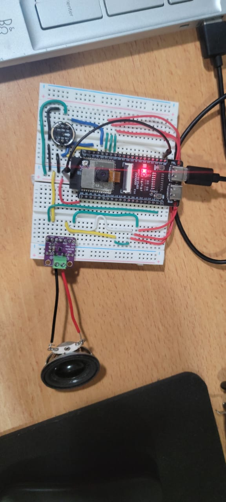
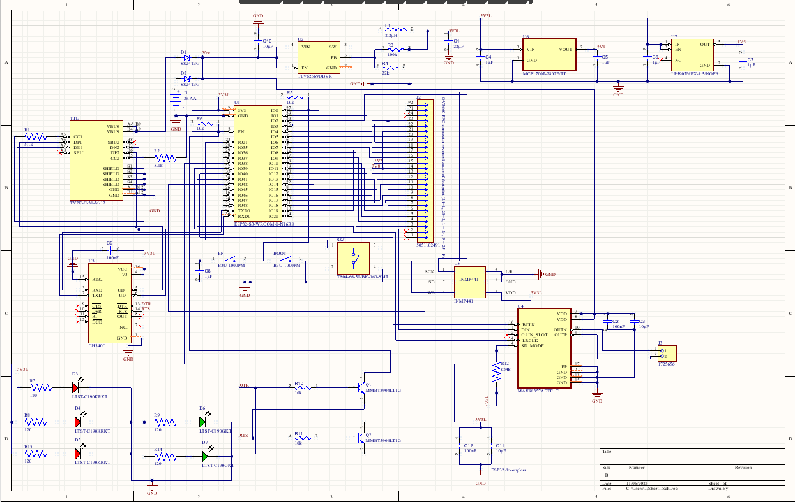
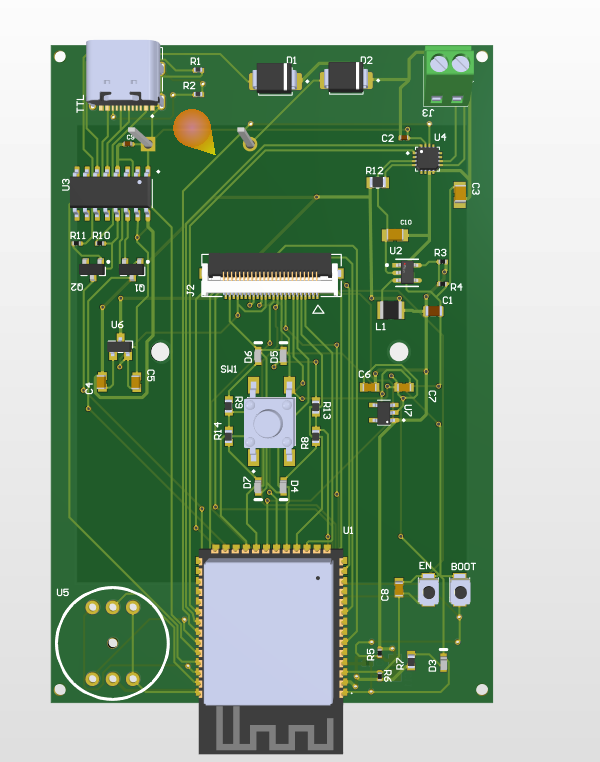

# Ranga — AI-Assisted Home Security & Intercom Project

> **Project documentation.** Ranga is a personal engineering project exploring a networked doorbell/intercom, local AI-assisted observation, and a self-hosted home-security stack. It is a prototype and learning project—not a finished, certified, or currently commercial product.

---

## What is Ranga?

Ranga is an attempt to build a home-security system from the ground up rather than treat a smart doorbell as a sealed appliance. The project combines an ESP32-S3 camera/audio endpoint, a browser-based live-view and intercom interface, self-hosted server services, and experiments with AI-based observation.

This is a **personal prototype with room to become more capable**. It is not presented as a production-ready security product. Reliability, security hardening, enclosure/weather resistance, power behaviour, and privacy controls, all need further validation.

## System at a glance

```text
                   Local network
┌───────────────────────┐       HTTPS / WSS       ┌──────────────────────────┐
│ ESP32-S3 camera/audio │ ──────────────────────> │ server-002               │
│ endpoint at the door  │ <────────────────────── │ Alpine Linux gateway     │
│                       │                         │ aiohttp + browser UI      │
│ OV3660 camera         │                         │ camera proxy + audio relay│
│ INMP441 digital mic   │                         └─────────────┬────────────┘
│ MAX98357A I²S amp     │                                       │
└───────────────────────┘                                       │ LAN/API workflows
                                                                ▼
                                                ┌──────────────────────────┐
                                                │ server-001               │
                                                │ Rocky Linux / AI host    │
                                                │ Ranga live + vision tools│
                                                │ Ollama / local LLM       │
                                                │ recording and data tools │
                                                └──────────────────────────┘
```

## Hardware and design choices

### Device prototype

| Part | Role | Why it was used / what was learned |
|---|---|---|
| ESP32-S3-CAM development board | Camera endpoint, Wi-Fi, I²S audio and device firmware | Provided a practical platform for proving the camera/audio concept before committing to a custom board. The exact module variant should be confirmed from the physical module marking and BOM. The firmware build configuration targets 16 MB flash and octal PSRAM (`qio_opi`/OPI settings). |
| OV3660 camera | Front-door image capture | Replaced the earlier OV7670 experiment. The ESP32 camera configuration uses JPEG, VGA frames, PSRAM frame buffers, and two frame buffers in the provided firmware. |
| INMP441 digital MEMS microphone | Door-side audio capture | Chosen after analog-microphone experiments. It sends digital I²S audio and includes its own conversion path, avoiding dependence on the ESP32's onboard ADC for microphone sampling. |
| MAX98357A I²S Class-D amplifier | Door-side speaker output | Replaced the LM386 analog amplifier path. I²S digital audio reduces the need for a separate analog DAC/audio chain and made the audio interface more directly compatible with the ESP32's digital audio peripheral. |
| Speaker | Audible output to the visitor | Experimented with 4ohms 3W, 8ohms 0.5W speakers |
| Breadboard, jumpers, USB power and development board | Early integration | Standard kit |

### Custom PCB direction

The supplied Altium-exported netlist represents a custom ESP32-S3-WROOM-1-N16R8-based board concept. 

- ESP32-S3-WROOM-1-N16R8 module (U1)
- OV3660 camera FPC connector, listed as a 24-way, 0.5 mm connector (J2; exact connector orientation/contact side should be checked against the schematic and datasheet)
- INMP441 microphone interface/module placeholder (U5)
- MAX98357AETE+T I²S amplifier (U4)
- CH340C USB-to-UART bridge (U3) and USB-C receptacle (TTL)
- USB/battery power selection using SS24T3G Schottky diodes (D1/D2)
- 3 × AA battery holder (J1)
- TLV62569 buck regulator (U2), inductor L1, and supporting passives
- EN and BOOT buttons, plus two-transistor auto-reset/boot circuitry
- Status LEDs and current-limiting resistors
- Speaker connector (J3)


### Reference links for core parts

These links point to manufacturer or distributor search/product pages where practical. Confirm the exact purchased module, breakout-board revision, and datasheet before building.

- [ESP32-S3 family / module documentation — Espressif](https://www.espressif.com/en/products/socs/esp32-s3)
- [INMP441 digital microphone — TDK/InvenSense product information](https://invensense.tdk.com/products/digital/inmp441/)
- [MAX98357A — Analog Devices product page](https://www.analog.com/en/products/max98357a.html)
- [MAX9814 — Analog Devices product page](https://www.analog.com/en/products/max9814.html)
- [OV3660 camera module search](https://www.google.com/search?q=OV3660+camera+module+datasheet)
- [CH340C — WCH product information](https://www.wch-ic.com/products/CH340.html)

The OV3660 and ESP32-S3-CAM are often sold as third-party assembled modules.

## The hardware journey:

### 1. First camera experiment: OV7670 + ESP32-WROOM-32 without PSRAM

The first major experiment used an OV7670 camera with a classic ESP32-WROOM-32 board that had no PSRAM. Getting camera frames into a browser was much harder than expected. The project could run a low-resolution QQVGA implementation, but attempts to move to higher QVGA settings led to instability, resets, or failures.

The key constraints were memory headroom and the cost of handling camera data in software. The camera, frame buffers, Wi-Fi stack, web server, and stream transport all compete for a small amount of RAM. Higher-resolution frames consume substantially more memory, and the lack of PSRAM left little room for larger buffers. Incomplete or inconsistent practical documentation for the particular OV7670/ESP32 combination made it difficult to distinguish pin/timing problems from memory and implementation limits.

This stage taught an important debugging lesson: when a low-resolution path works and a higher-resolution path crashes, trace the change in buffer sizes, allocation, pixel format, and timing before rewriting everything. 

### 2. Analog microphone experiments: cheap electret MEMS modules

A low-cost batch of miniature electret microphone modules—roughly ten for about six dollars—was an inexpensive way to experiment, but the results were inconsistent and did not provide the audio quality or predictability needed for a two-way intercom. The experience made the point that a low component price does not guarantee a useful system-level result. Sensitivity, noise, biasing, module quality, layout, and the surrounding analog circuit all matter.

### 3. MAX9814: a useful improvement, but not the final path

The MAX9814 microphone amplifier/AGC module improved the analog microphone signal. However, when integrated into the ESP32-S3-CAM streaming setup, the transmitted audio was still problematic. The working suspicion was that the ESP32-WROOM-32's ADC path and the sampling/streaming implementation were contributing to the problem; this was a hypothesis based on the observed behaviour, not a formally isolated root cause.

The next design iteration moved microphone conversion out of the ESP32's analog input path. That change reduced uncertainty at the boundary between the physical microphone and digital transport.

### 4. INMP441: move to digital I²S capture

The INMP441 provided digital audio over I²S and included the microphone's conversion circuitry. The firmware now configures I²S receive at 16 kHz with 32-bit input samples, then processes the data for transport. That made the microphone path more deterministic than reading an analog voltage through the ESP32 ADC without the need for heacy capacitive filtering as with the former MAX9814 and cheap 2mm eletret MEMs.

This was a design decision based on the complete system, not just a microphone specification: the signal needed to be captured, buffered, transmitted over Wi-Fi, and reconstructed in a browser(for prototype) or speaker without the analog conversion stage being a weak link.

### 5. LM386 to MAX98357A

The earlier LM386 approach used an analog amplifier path. The MAX98357A is an I²S-input Class-D amplifier, so the ESP32 can feed it digital audio directly. In practice, the move simplified the audio interface and was part of the broader shift toward I²S for both microphone capture and speaker playback.

The exact audible improvement depends on the speaker, power supply, gain, layout, enclosure, and test conditions.

## Firmware and data flow

The supplied firmware archive contains `src/main.cpp`, `platformio.ini`, and a browser UI under `static/`. The build configuration uses the Arduino framework through PlatformIO, the Espressif platform, and the `WebSocketsClient` library.

The firmware configuration in the archive includes:

- OV3660 pin mapping and an HTTP MJPEG endpoint at device port `8080`, path `/stream`
- JPEG camera frames configured at VGA with PSRAM frame buffers
- INMP441 I²S microphone capture at 16 kHz
- MAX98357A I²S speaker output at 16 kHz
- WebSocket audio connection to `server-002` on port `8000`, path `/ws/audio`
- A ring buffer for received 16-bit audio samples
- Separate I²S peripherals for microphone input and speaker output


## Server architecture

The supplied server structure snapshot shows a split deployment.

### server-002 — browser and device gateway

The gateway runs Alpine Linux. Its project directory contains `server.py`, a `static/` directory with the web UI (`index.html`, `app.js`, `style.css`), certificate files, a recording helper, and a Python virtual environment. The live server uses `aiohttp` and provides HTTPS/WSS on port 8000 in the captured configuration.

### server-001 — AI and processing host

This server is intended for heavier processing than the ESP32 can reasonably perform. The project has explored live observation, object/person detection and tracking, facial comparison/enrollment, recording/storage, speech output, and a local Ollama LLM engine.

## AI tools and development process

AI tools were used as development assistance, particularly to help draft and iterate on firmware/server code, explore debugging hypotheses, and speed up research across unfamiliar datasheets and libraries. 

## Media gallery — add your own project evidence


### Breadboard prototype




### Camera and two-way audio demo


### Altium schematic




### PCB layout / 3D view




## Repository and media setup
- **GitHub repository:** `https://github.com/Peter004/Ranga`
- **Portfolio URL:** `https://peteradebayo.vercel.app/`

Ranga is a learning-focused prototype. It is not a certified alarm system, guaranteed identity-verification system, or substitute for professionally installed security equipment. Test responsibly and make any necessary changes to fit or align with your use case.
